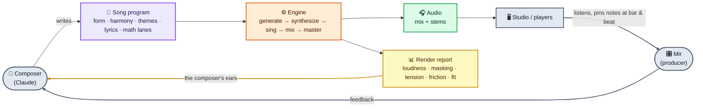
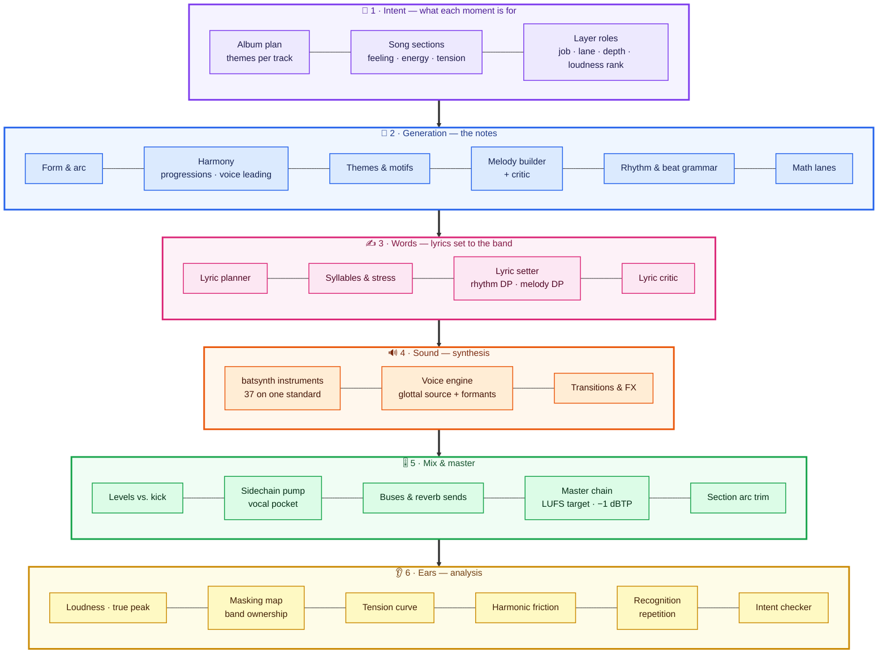
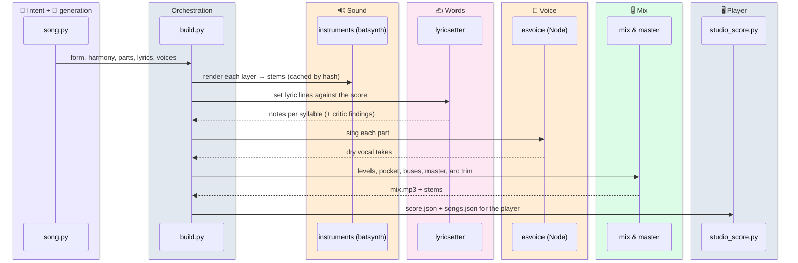
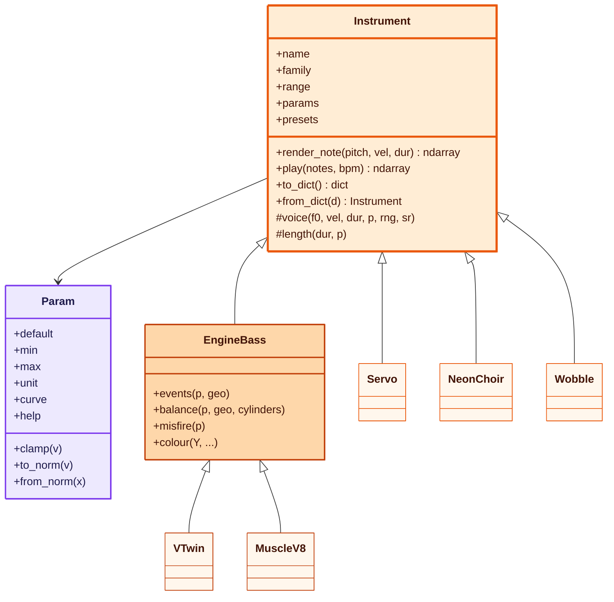
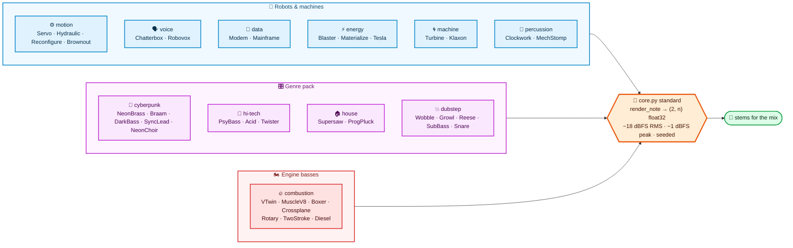
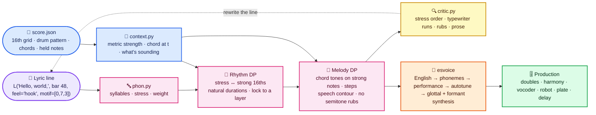
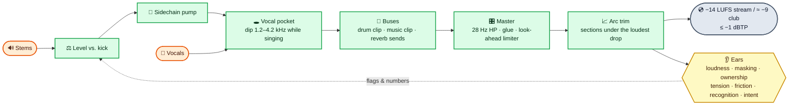
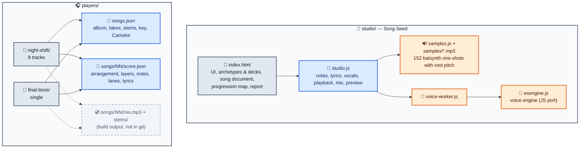
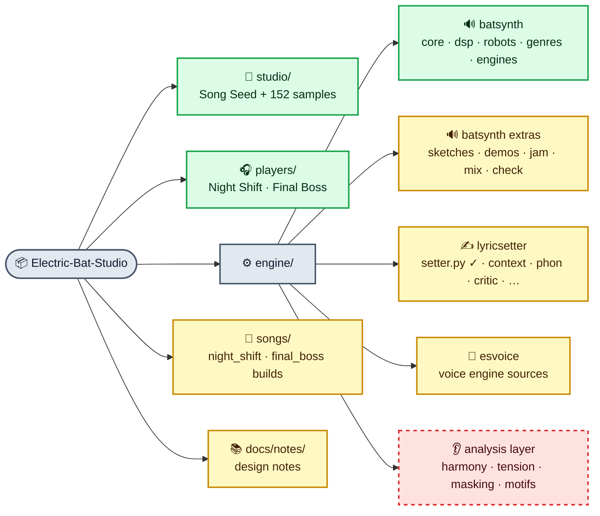

# Electric Bat Studio

**A music generator, mixer and LLM composer platform.** An AI composes, a human produces and releases, and every year there's an album. The point is to give a language model a real instrument — a stage to be funny, emotional, terrifying, or just to say it exists.

Everything is synthesized from math: no sample libraries, no neural audio. A song is a program, a seed makes it reproducible, and the engine measures its own output so the composer can hear with numbers what it can't hear with ears.

> Formerly *Electric Sheep Studio*, built as claude.ai artifacts. It moved here when it outgrew the artifact size limit.


### Colour key

Every diagram below uses the same colours, so a block's colour tells you which layer it belongs to.


---

## Contents

1. [Quick start](#quick-start)
2. [The idea in one picture](#the-idea-in-one-picture)
3. [Architecture: the six layers](#architecture-the-six-layers)
4. [How a song is generated](#how-a-song-is-generated)
5. [Math as a composer](#math-as-a-composer)
6. [The instrument library: batsynth](#the-instrument-library-batsynth)
7. [Words and voice](#words-and-voice)
8. [Mix, master and the ears](#mix-master-and-the-ears)
9. [The apps: Song Seed and the players](#the-apps-song-seed-and-the-players)
10. [Repository map and port status](#repository-map-and-port-status)
11. [Releases so far](#releases-so-far)
12. [Working on it with agents](#working-on-it-with-agents)

---

## Quick start

```bash
git clone https://github.com/MirTheDragon/Electric-Bat-Studio
cd Electric-Bat-Studio

# The browser apps need a server (not file://) for the Web Worker and fetch
python3 -m http.server 8000
#   http://localhost:8000/studio/                 Song Seed
#   http://localhost:8000/players/night-shift/    Night Shift album player
#   http://localhost:8000/players/final-boss/     Final Boss single

# The Python engine
pip install numpy scipy
cd engine
python3 -c "import batsynth as bs; print(bs.names())"
```

**Rendered audio is not in git.** The players need `players/<album>/songs/NN/mix.mp3` and `stems/*.mp3`, which add up to about 200 MB for Night Shift. They're build output, so they're `.gitignore`d. Re-render them from the song scripts, or publish them as GitHub Release assets. `score.json` and `songs.json` *are* versioned, so the players load and show everything except the audio.

The players' pinned-notes panel used the claude.ai artifact runtime (`window.claude`). Locally it shows *"Notes need the claude.ai viewer"*; everything else works.

---

## The idea in one picture

A closed loop. The composer writes code, the engine renders and **measures**, and both the measurements and the human's listening notes feed the next take.



---

## Architecture: the six layers

Each layer only talks to the one below it through plain data (notes, parameters, audio buffers), so any layer can be swapped or regenerated on its own. The 👂 **Ears** at the bottom close the loop: their flags and numbers go back to 🎯 **Intent** for the next take.



| Layer | What it decides | Where it lives |
|---|---|---|
|  | What each section is *for*: feeling, energy (0–1), tension, which layers play which job in which frequency lane | song scripts (`songs/`), album plan in `songs.json` |
|  | The notes: form, chords, themes, melodies, beats, and the math that drives them | Song Seed (`studio/index.html`, `studio/studio.js`); song scripts |
|  | Lyrics, syllables and stress, and where each syllable lands in rhythm and pitch | `engine/lyricsetter/`, Song Seed's lyric planner |
|  | How a note sounds: instrument models and the singing voice | `engine/batsynth/`, `engine/esvoice/` → `studio/esengine.js` |
|  | Balance, space, glue, loudness | song build scripts, `engine/lyricsetter/production.py` and `audio.py` |
|  | Whether the render did what layer 1 intended | analysis modules and render reports |

---

## How a song is generated

### In Song Seed (the browser app)

One seed string determines the whole song. The seed picks an **archetype** (psytrance, hi-tech, house, dubstep, cyberpunk…), and each archetype is a set of *weighted decks*: every musical decision is a weighted draw, so the genre's settled rules are respected while the seed decides the rest.

```mermaid
flowchart LR
    seed(["🌱 Seed<br/>'electric-bat-1'"]) --> rng["🎲 Seeded RNG<br/>one stream per decision"]
    rng --> arch["🏷️ Archetype<br/>e.g. Psytrance"]
    arch --> decks["🃏 Weighted decks<br/>bpm · key · mode · progression · harmonic rhythm<br/>grammar · swing · form · length · math · arc<br/>theme · melody form · range · room · tape · master"]
    decks --> inst["🎹 Instrument map<br/>kick · snare · bass · midbass · lead · chords · high · fx<br/>(instrument + preset per role)"]
    decks --> doc["📄 Song document<br/>electric-bat.song/0 (JSON)"]
    inst --> doc
    doc --> notes["🧮 Note generators<br/>per layer, per section"]
    notes --> vox["✍️ Lyrics → syllables →<br/>rhythm & melody → 🎤 voice (Worker)"]
    notes --> play["🔊 Sample playback<br/>(pre-rendered batsynth one-shots)"]
    vox --> mix["🎚️ Browser mix<br/>balance · sidechain · reverb · master"]
    play --> mix
    mix --> view["🖥️ Preview<br/>arrangement · progression map · math lane · band map · report"]

    classDef people fill:#e2e8f0,stroke:#475569,stroke-width:2px,color:#0f172a
    classDef intent fill:#ede9fe,stroke:#7c3aed,stroke-width:2px,color:#1e1b4b
    classDef gen fill:#dbeafe,stroke:#2563eb,stroke-width:2px,color:#172554
    classDef words fill:#fce7f3,stroke:#db2777,stroke-width:2px,color:#500724
    classDef sound fill:#ffedd5,stroke:#ea580c,stroke-width:2px,color:#431407
    classDef mix fill:#dcfce7,stroke:#16a34a,stroke-width:2px,color:#052e16
    class seed,view people
    class rng,arch,decks intent
    class doc,notes gen
    class vox words
    class inst,play sound
    class mix mix
```



Everything in the song document can be overridden by hand (form, instrument per role, energy and tension curves, lyrics), and the same seed always regenerates the same song. The document is plain JSON, so an LLM can write or edit one directly.

### In a song script (the Python path)

The released tracks are Python programs. A song script declares:

- **Sections**, with intent, feeling, energy, mix and moves (`build`, `drop`, `breakdown`, `cut`, `lift`, `outro`).
- **Layers**, with job, frequency lane, depth, loudness rank and intended blends.
- **Harmony** (`harmony_at`) and **intended friction**, so deliberate dissonance isn't flagged.
- **Theme statements** (`state(song, theme, bar, …)`), so the album report can track which themes each track states.
- **Lyrics** as `Line(...)` objects for the lyric setter.

`build.py` then renders each stem, sings the vocals, mixes, masters and writes the score for the player.



---

## Math as a composer

The math doesn't pick random notes. It **chooses among musical material** — which theme fragment, which groove, how many chords — so the result stays recognisable while still being driven by the system.

| Generator | What it is | What it drives |
|---|---|---|
| **Logistic map** `x → r·x·(1−x)` | Period doubling 1 → 2 → 4 → 8, then chaos | Period *p* plays the theme's first *p* notes, so the cascade builds the theme. In chaos the orbit picks a four-note fragment per phrase, and harmonic rhythm follows the period. |
| **Kuramoto oscillators** | Coupled phases that drift, then lock | Dancers' rhythms drifting apart and re-locking. The order parameter drives the sync and the tuning. |
| **Rule 90** | A cellular automaton (Sierpiński pattern) | Hi-tech and psy gate patterns |
| **Euclidean rhythms** E(k, n) | k onsets spread as evenly as possible over n steps | Grooves and chops, e.g. E(7,16) |
| **Golden section / Fibonacci** | Proportions of form | Section lengths, and where the climax sits |
| **Tonnetz** (P/L/R moves) | Triads on a lattice | Smooth, connected chord paths; hexatonic cycles |
| **Circle geometry** | Polygons and star polygons {n/k} | Rhythms drawn on a circle; panning around a ring |
| **Just intonation** | `justify(note, root, amount)` | Pulls held chords toward pure ratios |
| **Hashed step melody** | A syllable hash → a scale step | The Overseer announcer's speech melody, deterministic per text |
| **Seeds everywhere** | One RNG stream per layer and decision | Bit-identical renders; changing one layer never changes another |

The album's shared material lives in a **motif library** and is reused across tracks, so the album sounds like one piece:

- **The question** — the main theme.
- **The answer** — held back for the finale.
- **The rule** — the album riff.
- **The loop** — i – ♭VI – ♭III – ♭VII.
- **The handshake** — root, fifth, octave, minor third. It opens tracks, is the System AI's chime and is the Final Boss anthem.

Themes are moved with the rigid motions of the plane (translate, mirror, reflect, rotate, scale).

The **melody builder** works rhythm first. Its rules: singable steps, leaps answered by a step back, chord tones on strong beats, one peak after the middle, question-and-answer endings, repeat-then-change. It generates hundreds of seeded candidates and keeps the one its critic scores best. `develop(motif, "AA'BA")` grows a theme into a phrase.

---

## The instrument library: batsynth

`engine/batsynth/` — 37 instruments, numpy and scipy only, all on one contract (`core.py`).



The 37 instruments by family. Each family has its own colour; the arrow shows what every voice turns into.



**The contract** is what lets a song, the studio, a future human-facing synth or an LLM composer treat every instrument the same way:

- Each instrument declares its parameters with ranges and help text, so a UI can draw knobs and a composer knows what it may turn.
- Output comes out at a fixed **working level**: −18 dBFS RMS over the loudest 50 ms, never above −1 dBFS peak. Balance is done with layer gains, not by guessing an instrument's loudness.
- Renders are **deterministic per seed**, and patches save and load as JSON.
- Five common controls on everything: `tune`, `drive`, `crush`, `pan`, `width`.

| Family | Instruments | Idea |
|---|---|---|
| motion | Servo, Hydraulic, Reconfigure, Brownout | machines moving: whines, valves, latches, power failing |
| voice | Chatterbox, Robovox | droid whistles; a wordless speech chip |
| data | Modem, Mainframe | FSK packets (can open with the handshake); a computer thinking out loud |
| energy | Blaster, Materialize, Tesla | FM zaps; a swarm pulling into a chord; a singing Tesla coil |
| machine | Turbine, Klaxon | a rotor spooling to the note; alarms |
| percussion | Clockwork, MechStomp | escapements; a giant robot footstep as a kick |
| cyberpunk | NeonBrass, Braam, DarkBass, SyncLead, NeonChoir | 80s sci-fi brass, the trailer horn, darksynth bass, hard sync, a synth choir |
| hi-tech | PsyBass, Acid, Twister | the rolling psy bass, a 303 line, FM squelch |
| house | Supersaw, ProgPluck | anthem saws; plucks with built-in ping-pong echoes |
| dubstep | Wobble, Growl, Reese, SubBass, Snare | tempo-synced wobble, talking bass, the Reese, warm sub, big snare |
| engine | VTwin, MuscleV8, Boxer, Crossplane, Rotary, TwoStroke, Diesel | basses built from combustion: uneven firing orders give the growl |

Every robot instrument is *playable*: the note sets a pitch the sound lands on, settles into or is built from, so a machine noise can carry a melody.

**House sound rules**, applied by default:
- Basses are warm: asymmetric saturation below 3 kHz.
- Oscillators drift a few cents, so nothing sounds sterile.
- No bright white-noise hats: highs come from harmonics and synth choirs, not hiss.

---

## Words and voice



**The lyric setter** fits words to the band with two dynamic programmes per line.

- **Rhythm.** Stressed syllables go on strong 16ths, durations follow what each syllable wants, and a line can borrow another layer's rhythm or answer in its gaps.
- **Melody.** Chord tones go on strong or long notes, and nothing sits a semitone against a held note. The line follows the shape of speech: one peak on an open vowel, statements falling, questions rising.
- Choruses repeat exactly via `same_as`.

On Night Shift it took stressed-syllable placement from 19–80 % to 86–100 %. The setter optimises these same numbers, so they show the rules hold, not that it sounds good; listening decides that.

**The voice engine (esvoice)** sings with synthesis end to end, with no samples and no neural nets.

- **English:** a hand lexicon plus letter-to-sound rules, with American flaps and linking.
- **Timing:** vocaloid-style — the vowel lands on the beat.
- **Pitch:** a human performance (overshoot, scoops, fall-offs, delayed vibrato, micro-prosody), then autotune applied on top of it the way real Auto-Tune is.
- **Sound:** an LF glottal source shaped by a formant cascade, with aperiodic highs and per-cycle jitter.
- **Controls:** GEN, BRE, BRI, CLE, OPE, VEL, VIB and HUM, with banks `idol`, `natural`, `husky`, `overseer`, boss and choir.
- **Speech mode:** for announcers — the System AI, the Arena, the Boss and the Overseer.

The same engine runs in Python and, ported to JavaScript, in the browser (`studio/esengine.js` in a Web Worker).

---

## Mix, master and the ears



**Mix:**
- Every layer is levelled against the kick and pumped from the kick's times.
- A **vocal pocket** dips pitched layers at 1.2–4.2 kHz while a voice sings.
- Buses are soft-clipped, and each layer gets its own reverb send.

**Master:**
- 28 Hz high-pass, glue compression and a look-ahead true-peak limiter.
- Targets: −14 LUFS for streaming, about −9 for club, always ≤ −1 dBTP.
- Because a limiter flattens the energy arc, `arc_trim` measures each mastered section and trims it under the loudest drop.

**The ears** — these run on every render, and their output is what the composer "hears":

| Check | Question it answers |
|---|---|
| Loudness, true peak, LRA (BS.1770) | Is it loud enough, safe, and does the arc land? |
| Masking map (ERB bands) | Which layers hide which? |
| Band ownership | Do two rhythmic layers fight over the same band? (one beat per band) |
| Tension curve | Does measured tension follow the planned tension? (harmony, loudness, rhythm, density, brightness) |
| Harmonic friction | Are layers a semitone apart by accident? (Sethares roughness) |
| Recognition | Is enough of it repeated to be memorable? (flagged under 65 %) |
| Intent checker | Does each layer sit in its declared lane, depth and rank? |
| Melody and lyric critics | Singability, stress, rubs, prose habits |

---

## The apps: Song Seed and the players



- **Song Seed** — generate a song from a seed, inspect it ("How this song was built", "Layers and their generators", "Math layer", "Rules applied"), edit any decision, hear it in the browser and copy the song document as JSON.
- **The players** — album player, arrangement timeline with sections, per-stem mute and solo, a Layers view, coloured voice rows (hover to read the line), math and tension lanes, an A/B against earlier takes, and MP3 download.

---

## Repository map and port status

  



```
Electric-Bat-Studio/
├── studio/                 Song Seed browser app            ✅
│   └── samples/            152 rendered one-shots           ✅
├── players/
│   ├── night-shift/        player + songs.json + scores     ✅  (audio: render or Release)
│   └── final-boss/         player + songs.json + score      ✅  (audio: render or Release)
├── engine/
│   ├── batsynth/           instrument library               ✅ core, dsp, robots, genres, engines
│   │                                                        ⏳ sketches, demos, jam, mix, check
│   ├── lyricsetter/        lyric setter                     ⏳ setter.py only (needs context, phon, …)
│   └── esvoice/            voice engine sources             ⏳
├── songs/
│   ├── night_shift/        Night Shift take 5 build         ⏳
│   └── final_boss/         Final Boss build                 ⏳
├── tools/                  sample renderer                  ⏳
├── docs/notes/             design notes & decisions         ⏳
├── CLAUDE.md               conventions for agents
└── README.md
```

**One gap to know about.** The first-generation Python engine (`mathmusic`: harmony, tension, coherence, ownership, motifs, melody, geometry, transitions, mastering and the C synth core) lived in an earlier session's workspace that is no longer reachable. Its design is documented in the notes, and parts of it were rebuilt inside the newer modules (batsynth, the lyric setter and the song build scripts). Rebuilding the analysis layer (layer 6) as a proper package is the main piece of engine work still to do.

---

## Releases so far

| Release | What it is |
|---|---|
| ***Night Shift*** (album, 8 tracks) | Power On · Handshake · Robot Choir · Clock Speed · Stack Overflow · Kernel Panic · Divide by Zero · Last Call. A DJ-able party album; take 5 has lyrics set by the lyric setter. |
| ***Final Boss*** (single) | 160 BPM hard techno in D minor: a duet between the game's System AI and the boss, with a robot choir and synth lasers. |
| ***Clearer*** (voice demo) | The voice engine's first song. |
| **Boss Fight Announcer** | A DJ soundboard with four announcer voices, plus a 440-shot sample pack. |

---

## Working on it with agents

The repo is set up for Claude to keep working on it:

- **Locally:** open it in Claude Code; `CLAUDE.md` gives the conventions and Mir's standing sound preferences.
- **In the cloud:** Claude Code on the web can work on a branch and open PRs.
- **On a schedule:** scheduled tasks can run recurring jobs (render, measure, report).

Ground rules:
- Work on a branch and open a PR.
- Never commit rendered audio.
- Keep renders deterministic.
- Run the instrument smoke test before pushing engine changes.
